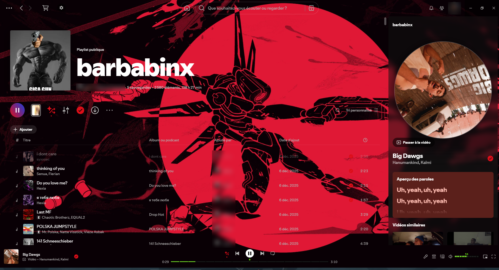

# Custom-Spotify-Extended



**Custom-Spotify-Extended** is a Spicetify extension that lets you customize almost everything in Spotify from a single settings window. Click the gear button at the top left, tweak what you like and save it as a preset.

## Features

- **Wallpaper**: your own image (from your PC or a link), the current track's cover art, or its Canvas video, with blur and opacity controls.
- **Transparency**: separate opacity for every area (library, main page, right panel, top bar, player bar).
- **Compact panels**: shrink or fully hide the library and the right panel; they open when you hover the screen edge.
- **Vinyl mode**: the cover art spins like a record in the right panel.
- **Colors**: pick any accent color, or a two-color gradient.
- **Progress and volume bars**: Spotify, custom (colors, gradient, height, glow) or Pixel style.
- **Buttons**: restyle the play, skip, shuffle, repeat and like buttons.
- **Themes**: Original, Pixel and Lofi, plus fonts and square corners.
- **Presets**: save as many setups as you want and switch between them in one click.
- **Languages**: English and French.

## Installation

**Marketplace:** open the Spicetify Marketplace, search for *Custom-Spotify-Extended* and click Install.

**Manual:**

1. Copy `custom-spotify-extended.js` into your Spicetify `Extensions` folder (`%appdata%\spicetify\Extensions` on Windows, `~/.config/spicetify/Extensions` on Linux/macOS).
2. Run:
   ```
   spicetify config extensions custom-spotify-extended.js
   spicetify apply
   ```

## Author

Made by Natan. Released under the MIT License.
